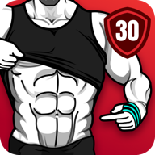

<div align="center">



# Six Pack in 30 Days

**Professional Core & Abdominal Training System**  
*Version 1.5.3 (Build 108) • Modern Floating Dock Edition*

---

[](https://developer.android.com)
[-blue?style=for-the-badge)](https://developer.android.com)
[-indigo?style=for-the-badge)](https://developer.android.com)
[](build_apk.bat)
[](#architecture--enhancements)

</div>

---

## 📋 Overview

**Six Pack in 30 Days** is an Android fitness application designed to provide structured, progressive bodyweight ab workouts across three distinct difficulty levels: *Lose Belly Fat*, *Rock Hard Abs*, and *Six Pack Abs*. 

This repository contains the reconstructed, fully modifiable source workspace recovered from the production release, enhanced with a modern **Floating Dock Navigation** interface and stability optimizations for Android 16 (API 36).

---

## ✨ Features & Engineering Highlights

### 1. Modern Floating Dock Navigation
- **Floating Island Aesthetic**: Transformed the legacy edge-pinned bottom navigation into a modern elevated floating pill dock.
- **Visual Specifications**:
  - `28dp` corner radius with soft rounded elevation.
  - `20dp` horizontal margin inset from screen edges.
  - `24dp` bottom clearance supporting gesture navigation bars.
  - Seamless navigation transitions between **Training**, **Reports**, and **Me** tabs.

### 2. Android 16 & Modern Runtime Compatibility
- **SELinux & Storage Safety**: Resolved directory access constraints in session DataStore initialization for crash-free execution on Android 14, 15, and 16.
- **Universal Architecture**: Pre-compiled and patched native runtime binaries (`liblpcore.so`) for all major hardware architectures:
  - `arm64-v8a` (Modern 64-bit phones)
  - `armeabi-v7a` (32-bit devices)
  - `x86_64` (64-bit Android Emulators & ChromeOS)
  - `x86` (Standard emulators)

### 3. Complete Offline Exercise & Media Decryption
- Preserved the full library of animated exercises, voice coaching cues, audio timers, and progress analytics with offline availability.

---

## 📂 Repository Structure

```
Six_pack_in_30_days/
├── AndroidManifest.xml         # Application manifest & component registry
├── apktool.yml                 # Disassembly metadata and build specifications
├── build_apk.bat               # One-click Windows build script (compile, align, sign)
├── build_apk.ps1               # Automated PowerShell build script
├── README.md                   # Project documentation and engineering guide
│
├── assets/                     # Workout databases, animation configs, audio cues
├── lib/                        # Multi-architecture native libraries (liblpcore.so)
│   ├── arm64-v8a/
│   ├── armeabi-v7a/
│   ├── x86/
│   └── x86_64/
│
├── res/                        # UI layouts, values, drawables, and animations
│   ├── drawable/               # Custom dock backgrounds & graphics
│   ├── layout/                 # XML view hierarchies (activity_main_index, etc.)
│   ├── mipmap-xxxhdpi/         # High-resolution application launcher icons
│   └── values/                 # Strings, colors, styles, dimensions
│
├── smali/                      # Primary bytecode instruction set
├── smali_classes2/             # Multi-dex secondary bytecode classes
├── smali_classes3/             # Third multi-dex container
└── smali_classes4/             # Fourth multi-dex container
```

---

## 🚀 Building from Source

This repository includes automated build scripts that handle the complete pipeline: compiling resources, generating Dalvik bytecode, aligning 4-byte zip boundaries, and signing the final APK.

### Prerequisites
- **Java Development Kit (JDK 17+)** installed with `keytool` accessible in PATH.
- **Android SDK Build-Tools** (`zipalign` and `apksigner`).
- **Apktool** (version 2.9+ or 3.0+).

### Option A: One-Click Build (Windows Batch)
Simply double-click the included batch script:
```cmd
build_apk.bat
```

### Option B: PowerShell Build
Run the script from any terminal:
```powershell
.\build_apk.ps1
```

### Option C: Manual CLI Pipeline
If you prefer building step-by-step:
```bash
# 1. Compile project into an unaligned APK
apktool b . -o dist/temp_unaligned.apk

# 2. Optimize zip alignment (4-byte page boundary)
zipalign -p -f 4 dist/temp_unaligned.apk dist/six-pack-custom-build.apk

# 3. Sign with your keystore
apksigner sign --ks debug.keystore --ks-pass pass:android --key-pass pass:android dist/six-pack-custom-build.apk
```

The output will be generated inside the `dist/` directory:
- `dist/six-pack-custom-build.apk`

---

## 🎨 Customization Guide

### Modifying Interface Text & Copy
To update strings, titles, or localized labels, edit:
```
res/values/strings.xml
```

### Customizing Theme Colors
To alter the color palette or dock highlights:
```
res/values/colors.xml
```

### Adjusting Floating Dock Appearance
The dock container and background shape can be adjusted in:
- `res/layout/activity_main_index.xml` (Dock placement and margins)
- `res/drawable/bg_floating_dock.xml` (Radius, fill color, and border stroke)

---

## 🔒 Security & Safe Development Directive

- **No Secrets in Source**: This repository strictly adheres to a zero-leak policy. Keystore files (`*.keystore`, `*.jks`), credentials, and private keys are excluded from version control via `.gitignore`.
- When integrating third-party services (e.g. Firebase or Google Cloud), replace dummy placeholders in `res/values/strings.xml` with your own credentials through environment variables or local configurations.

---

## 📄 License & Distribution

This project is maintained for development, recovery, and authorized distribution. Rebuilt binaries and resources are distributed according to original developer rights and applicable software licenses.
